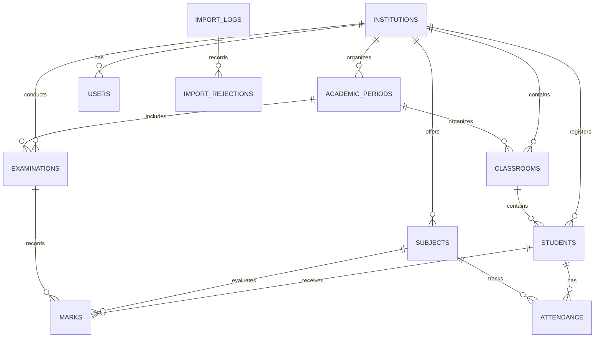

# Database Design – School Intelligence

## 1. Overview

The School Intelligence application uses PostgreSQL as its relational database.

SQLAlchemy 2.0 is used for ORM-based database operations, and Alembic manages database schema migrations.

The database stores institutional information, academic periods, classes, students, subjects, examinations, marks, attendance records, user accounts and import history.

The database is designed to support:

- Academic data management.
- Student performance analytics.
- Subject-wise attendance analytics.
- Machine learning feature generation.
- AI-based academic information retrieval.
- Report generation.
- Authentication and authorization.
- Import tracking and rejection management.

## 2. Database Configuration

The database connection is configured using backend environment variables.

| Setting | Configuration |
|---|---|
| Database system | PostgreSQL |
| Database name | `school_intelligence` |
| Host | `localhost` |
| Port | `5432` |
| ORM | SQLAlchemy 2.0 |
| Migration tool | Alembic |

Database credentials are maintained in the backend `.env` file and must not be committed to Git.

## 3. Database Entities

The application includes the following primary database entities.

| Table / Model | Purpose |
|---|---|
| `institutions` | Stores institution information |
| `academic_periods` | Stores academic periods |
| `classrooms` | Stores class and section information |
| `students` | Stores student information |
| `subjects` | Stores subject information |
| `examinations` | Stores examination information |
| `marks` | Stores student examination marks |
| `attendance` | Stores subject-wise attendance sessions |
| `users` | Stores application user accounts and access information |
| `import_logs` | Stores uploaded-file import history |
| `import_rejections` | Stores records rejected during imports |

The SQLAlchemy model definitions in `backend/app/models/` are the source of truth for exact column names, data types, constraints and relationship definitions.

## 4. Entity Responsibilities

### 4.1 Institutions

The Institution entity represents the school or institution whose academic information is managed by the application.

It provides the institutional context for academic records and authenticated users.

### 4.2 Academic Periods

The AcademicPeriod entity represents an academic year or period.

Academic periods allow examination and academic information to be organized across different school years.

### 4.3 Classrooms

The Classroom entity stores class and section information.

It connects students to their academic class and supports class-level analytics.

### 4.4 Students

The Student entity stores student-related information, including the information needed to identify students within the academic system.

Student records are used by marks, attendance, analytics, reports and ML prediction workflows.

### 4.5 Subjects

The Subject entity stores the subjects offered by the institution.

Subject information is used to organize examination marks, attendance and subject-wise performance analytics.

### 4.6 Examinations

The Examination entity stores examination information and associates examinations with their academic context.

Examination records are used to compare student performance across examination periods and generate future-examination predictions.

### 4.7 Marks

The Mark entity stores student examination results.

Mark records provide the academic information required for:

- Student performance calculations.
- Subject-wise averages.
- Examination comparisons.
- Declining-performance analysis.
- ML feature generation.
- Academic reports.

### 4.8 Attendance

The Attendance entity stores subject-wise attendance session information.

Attendance records support:

- Student attendance percentages.
- Subject-wise attendance analytics.
- Class-level attendance summaries.
- Low-attendance identification.
- Attendance and academic-performance analysis.
- ML attendance feature generation.

### 4.9 Users

The User entity stores application user accounts and their access information.

Authentication uses stored password hashes rather than plaintext passwords.

User information also provides the institution and role context required by protected API operations.

### 4.10 Import Logs

The ImportLog entity stores information about uploaded data imports.

It supports import-history reporting and review of completed import operations.

### 4.11 Import Rejections

The ImportRejection entity stores records rejected during data imports and their rejection reasons.

This helps administrators understand data-quality issues and correct invalid source files.

## 5. Entity Relationships

The database follows a relational structure in which academic records are connected through identifiers and foreign-key relationships.

The main logical relationships include:

- An institution contains academic periods, classrooms, students, subjects, examinations and users.
- An academic period organizes its associated classes and examinations.
- A classroom contains student records.
- A student can have multiple examination mark records.
- A student can have multiple attendance records.
- A subject can be associated with multiple mark and attendance records.
- An examination can contain mark records for multiple students and subjects.
- An import log can be associated with its rejected import records.

The exact cardinalities and foreign-key constraints must be read from the SQLAlchemy model definitions and Alembic migrations.

## 6. Logical Entity Relationship Diagram

The following diagram shows the main academic relationships conceptually.



This is a conceptual diagram of the academic data model, not a replacement for the exact physical database schema.

## 7. Academic Data Flow

### 7.1 Student Data

Student information is imported and stored in the students table.

Student records are associated with the relevant institution and classroom.

### 7.2 Examination Marks

Examination marks are associated with students, subjects and examinations.

The application uses these records to calculate academic performance and examination comparisons.

### 7.3 Attendance Records

Attendance information is stored as subject-wise session records.

The application uses attendance records to calculate attendance percentages and analyze attendance patterns.

### 7.4 Machine Learning Features

The ML feature service retrieves historical marks and attendance information from PostgreSQL.

It calculates the required prediction features using information available before the target examination.

The trained model receives the generated features and returns the prediction result.

### 7.5 AI Academic Retrieval

The AI Academic Assistant retrieves relevant academic information using SQL queries and backend services.

The retrieved information is passed to the language model as context for generating academic explanations.

### 7.6 Reporting

The reporting services retrieve academic records and aggregated results from the database.

The results are used for report previews and Excel/PDF exports.

## 8. Data Integrity and Validation

The application uses relational database constraints and backend validation to maintain data consistency.

Important validation areas include:

- Valid student references.
- Valid subject references.
- Valid examination references.
- Valid academic-period associations.
- Valid attendance information.
- Valid examination mark information.
- Institution-scoped data access.
- Required import fields.

The import module also records rejected records and rejection reasons.

Database constraints and application-level validation serve complementary purposes.

## 9. Database Migration Management

Alembic is used to manage database schema changes.

Migration files are maintained in:

`backend/alembic/versions/`

### Common commands

Check the current migration revision:

```bash
alembic current
```

View migration history:

```bash
alembic history
```

Generate a migration revision:

```bash
alembic revision --autogenerate -m "describe_schema_change"
```

Apply migrations:

```bash
alembic upgrade head
```

The generated migration should be reviewed before it is applied.

## 10. Data Import Tracking

The import system maintains import history and rejected-record information.

The import process supports:

1. Receiving CSV or Excel files.
2. Reading uploaded records.
3. Validating required data.
4. Checking academic references.
5. Processing valid records.
6. Recording rejected records and reasons.
7. Returning an import summary.

The import-history and rejection endpoints allow users to review the results of previous uploads.

## 11. Security Considerations

Academic records contain sensitive student information.

The application uses JWT authentication to protect API access.

Important security considerations include:

- Password hashing.
- Protected API endpoints.
- Role-based authorization where applicable.
- Institution-scoped academic retrieval.
- Environment-based database credentials.
- Restricted access to student information.
- Avoiding exposure of secrets in source control.

Institution-level isolation must be maintained for operations that support multiple institutions.

## 12. Database Limitations

1. The current demonstration uses synthetic academic data.
2. Data quality depends on the correctness of imported records.
3. Missing marks or attendance sessions can affect analytics and ML feature generation.
4. Incorrect academic relationships can affect report accuracy.
5. Production deployment requires appropriate backup, recovery and monitoring procedures.
6. The conceptual relationship diagram does not specify every physical database constraint.

## 13. Conclusion

The School Intelligence database provides a relational foundation for academic data management, analytics, machine learning, AI assistance and reporting.

PostgreSQL stores the academic records, SQLAlchemy manages database interactions, and Alembic tracks schema changes.

The database design supports the application's main workflows while maintaining structured relationships between institutions, academic periods, students, subjects, examinations, marks and attendance.